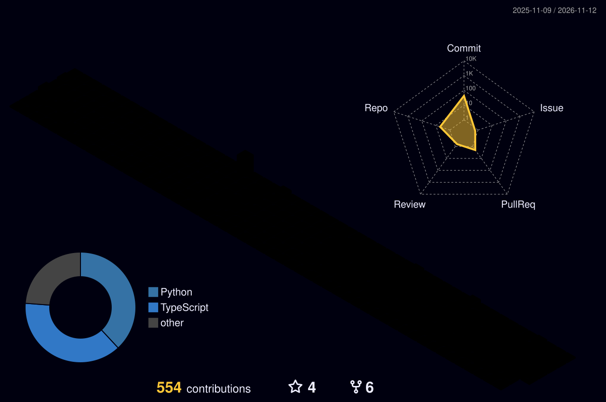

<div align="center">

# Hi there, I'm Madhur Dixit! 👋

<a href="https://github.com/MadhurDixit13">
  
</a>

<p>
  <a href="https://www.linkedin.com/in/madixit"></a>
  <a href="https://madhurdixit13.github.io/Portfolio/"></a>
  <a href="https://medium.com/@madhurdixit37"></a>
  <a href="mailto:madhurdixit37@gmail.com"></a>
</p>


</div>

---

## 🙋 About Me

- 💼 Currently a **Software Developer at Cultivate AI**, building AI agents and data pipelines for credit unions
- 🎓 **MS Computer Science**, NC State University (2023–2025) · **B.E. Computer Engineering**, University of Mumbai (2019–2023)
- 🛠️ I build ML infrastructure, data pipelines, and AI agents, from Airflow DAGs to LangChain hybrid-search agents
- 📄 Published at **ASEE 2025** and **FIE 2025** on LLMs in CS education
- 💬 Ask me about data lakes vs. warehouses, Spark internals, or FastAPI performance

---

## 🚀 Featured Projects

<table>
<tr>
<td width="50%" valign="top">

### 📊 [SentimentFlow](https://github.com/MadhurDixit13/SentimentFlow)
Reddit sentiment pipeline: **Airflow → S3 (Parquet) → Streamlit**, containerized with Docker and deployed to EC2 via GitHub Actions CI/CD.


</td>
<td width="50%" valign="top">

### 🧮 [csv-summary-cli](https://github.com/MadhurDixit13/csv_summary_cli)
Lightweight CLI that summarizes CSV files with column stats. Published on PyPI.

[](https://pypi.org/project/csv-summary-cli/)


```bash
pipx install csv-summary-cli
```

</td>
</tr>
</table>

---

## 🧰 Tech Stack

| Category | Tools |
|---|---|
| **Languages** |     |
| **Data Engineering** |       |
| **AI / ML** |   |
| **Backend / Web** |   |
| **Cloud / DevOps** |     |

---

<details>
<summary><b>💼 Work Experience (click to expand)</b></summary>
<br>

**Software Developer** · Cultivate AI · Raleigh, NC · *Jun 2026 – Present*
- Built agent tools for an AI assistant serving credit unions (Python/FastAPI, React/TypeScript), including sandboxed code execution on AWS Bedrock AgentCore that generates Word, Excel, PowerPoint, PDF, and chart files.
- Added a persistent per-user bash workspace (up to 100 MB across messages), parallel tool execution, and automatic failover to backup LLMs during provider outages.
- Cut worst-case keyword search latency 40x (2.7s → 63ms) with Postgres trigram indexes, and ingested 1,300+ NCUA regulatory documents into AI search.
- Engineered regulatory news scrapers (RSS, WordPress APIs, custom HTML parsers) running every 6 hours on AWS EventBridge Scheduler.
- Secured a multi-tenant platform with folder-level permissions and user groups enforced through Postgres row-level security, and sandboxed AI-generated SQL in memory-capped processes.
- Identified and fixed a metric error that overstated loan delinquency 4x across all production data.

**Software Developer** · Runara.ai · San Jose, CA · *Jul 2025 – Mar 2026*
- Reduced contract review time by 70% by engineering an automated approval workflow with Airflow and FastAPI.
- Cut AWS cloud costs by 35% through instance right-sizing, architectural refactoring, and managed services.
- Architected a centralized FusionAuth service for unified auth, reducing development and hosting overhead.
- Directed a flagship product's development, incorporating requirements from 10+ clients to guide features and A/B testing.

**Senior Consultant (Volunteer)** · Heartland Community Network · Cincinnati, OH · *Jun 2025 – Jan 2026*
- Led the team's transition from Google Docs to Jira, significantly improving project tracking and productivity.
- Built a context-aware LangChain agent with hybrid search (SQL/Vector/Graph), improving response accuracy by 25%.

**Data Engineer** · Liquid Rocketry Lab · Raleigh, NC · *Sep 2024 – May 2025*
- Slashed sensor data retrieval time by 96% (50s → 2s) by migrating InfluxDB queries from InfluxQL to Flux.
- Reduced API response time by 40% by migrating the backend from Flask to FastAPI.
- Restructured the database schema to eliminate session conflicts and improve data integrity.

**Software Engineer Intern** · Digiliyo · Mumbai, India · *Sep 2021 – Nov 2021*
- Modernized web pages with React, boosting conversions by 15%, and built user analytics dashboards.
- Implemented Redis caching, cutting web app response time by 25%.

**Software Engineer Intern** · Perch Furnitures · Mumbai, India · *Feb 2021 – Aug 2021*
- Increased customer interaction by 10% with a React product page informed by 3 user studies; built unit tests for the catalog.

</details>

<details>
<summary><b>📄 Research (click to expand)</b></summary>
<br>

- [**"In the Age of LLMs, Is Dual-Submission Homework Dead?"**](https://peer.asee.org/in-the-age-of-llms-is-dual-submission-homework-dead.pdf)
  
- [**"Reflective Homework as a Learning Tool: Evidence from Comparing 13 Years of Dual vs. Single Submission"**](https://arxiv.org/html/2508.09314v1)
   [](https://arxiv.org/abs/2508.09314)

</details>

<details>
<summary><b>✍️ Latest Blogs (auto-updated, click to expand)</b></summary>
<br>

<!-- BLOG-POST-LIST:START -->
- [Diving Under the Hood of Spark with MiniSpark: A Pure-Python Learning Playground](https://medium.com/@madhurdixit37/diving-under-the-hood-of-spark-with-minispark-a-pure-python-learning-playground-afe8fd21e90b?source=rss-6b4d20021e66------2)
- [Athena vs Redshift: A Real-World Data Lake vs Warehouse Comparison Using COVID-19 Data](https://medium.com/@madhurdixit37/athena-vs-redshift-a-real-world-data-lake-vs-warehouse-comparison-using-covid-19-data-1c0c2560bc89?source=rss-6b4d20021e66------2)
<!-- BLOG-POST-LIST:END -->

</details>

---

## 📊 GitHub Stats

<div align="center">

<picture>
  <source media="(prefers-color-scheme: dark)" srcset="./profile-3d-contrib/profile-night-rainbow.svg" />
  <source media="(prefers-color-scheme: light)" srcset="./profile-3d-contrib/profile-green-animate.svg" />
  
</picture>


</div>

---

## 🎧 Now Playing

<div align="center">

[](https://github.com/kittinan/spotify-github-profile)

</div>

---

<div align="center">

💬 **Let's connect and build something cool!** Reach out via [email](mailto:madhurdixit37@gmail.com) or [LinkedIn](https://www.linkedin.com/in/madixit).

</div>
